<div align="center">


</div>

---

<h1 align="center">👋 Olá, tudo bem?</h1>

<p align="center">
Sou <b>desenvolvedor full stack júnior</b> e trabalho na evolução de um <b>ERP de vendas</b>,<br/>
construindo funcionalidades de ponta a ponta, com testes, jobs assíncronos e foco em confiabilidade.
</p>

```ruby
class Igor
  ROLE     = "Full Stack Developer"
  STACK    = %w[Ruby Rails React JavaScript]
  QUALITY  = %w[RSpec CodeReview CleanCode]
  ASYNC    = %w[Sidekiq]
  MINDSET  = "testar, observar, melhorar"

  def entrega
    "Funcionalidades confiáveis, relatórios claros e bugs resolvidos na causa raiz"
  end
end
```

---

### 💻 Tech Stack

<div align="center">

<!-- Remova os ícones das tecnologias que você não usa de verdade -->

<br/>

<br/>


</div>

---

<h2 align="center">⚡ Engineering Blueprint</h2>

<div align="center">
  <picture>
    <source media="(prefers-color-scheme: dark)" srcset="https://raw.githubusercontent.com/JIgor-Silva/JIgor-Silva/output/galaga-contribution-graph-dark.svg" />
    
  </picture>
</div>

---

### 🤝 Vamos conversar?

<div align="center">
Aberto a oportunidades como <b>Desenvolvedor Full Stack / Back-end</b>.
<br/><br/>
<a href="https://www.linkedin.com/in/igor-m-silva/"></a>
<br/><br/>

</div>
